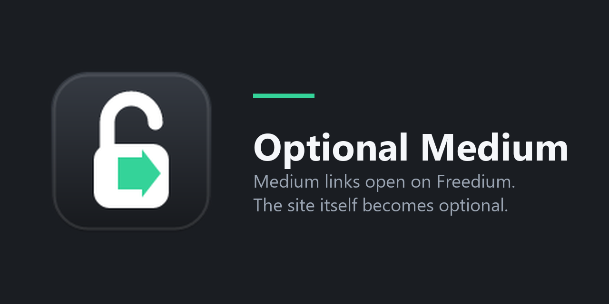

# Optional Medium

**Medium links open on Freedium. The site itself becomes optional.**

A small browser extension that stops Medium from being the only way you read Medium.
Click, paste, or type any Medium link and it opens the same article on a Freedium
mirror — no paywall wall, no login prompt, no "member-only" truncation.

Works on `medium.com`, `medium.com/@author/...` publications, `*.medium.com`
subdomains, and custom-domain Medium blogs.

---

## Install

**Option A — from the build** (works in any Chromium browser)

1. Download `optional-medium.crx` from the [latest release](https://github.com/GreatHavoc/optional-medium/releases/latest).
2. Open `chrome://extensions` (or your browser's equivalent) and turn on **Developer mode**.
3. Drag the `.crx` file onto that page.

> Stock Chrome on Windows/macOS blocks extensions from outside the Web Store, so
> there drag-drop refuses to work — use Option B instead. Chromium forks that don't
> enforce the store accept it.

**Option B — from source**

1. Download and unzip the [release zip](https://github.com/GreatHavoc/optional-medium/releases/latest),
   or `git clone` this repo.
2. `chrome://extensions` → **Developer mode** on → **Load unpacked** → select the folder.
3. Reload the extensions page if you edit anything later.

Done. No configuration needed — it redirects on install.

---

## Use it

Just browse normally. Any Medium link — from Google, X, a newsletter, your
bookmarks — opens on the mirror instead.

**Reading normally.** The article loads on the mirror. Text is complete and free.

**Want the original anyway?** Links clicked *from inside* the mirror page are left
alone, so its own "open original article" button still takes you to Medium. If you
want Medium for one link only, copy the URL and open it in a private window with the
extension disabled, or just disable the redirect in the popup first.

**Pause it.** Click the toolbar icon → untick **Redirect Medium links** → Save.

**Add another custom-domain blog.** Same popup, paste the domain(s) into
**Extra Medium custom domains** (one per line, e.g. `blog.example.com`),
Save, and accept the browser's access prompt for each. From then on those
publications redirect too.

**The mirror went down?** Freedium's domains rotate and the current one may die.
The popup's **Mirror domain** field is the only thing you change — type the working
one (currently `freedium-mirror.cfd`), Save, and links start resolving again.
Nothing else to edit, no rebuild.

---

## Settings

| Field | Default | What it does |
|---|---|---|
| Redirect Medium links | on | Master switch; off = plain browsing, extension inert |
| Mirror domain | `freedium-mirror.cfd` | Which Freedium instance links go to |
| Extra Medium custom domains | *(a starter example)* | Custom-domain Medium blogs to include |

---

## When it doesn't work

**The article shows on Medium anyway.** The link was clicked from the mirror page itself
(by design) or the domain isn't in the list above. Add it in the popup.

**The mirror page is blank or errors.** That mirror is down — change **Mirror domain**
in the popup to the current Freedium domain.

**Nothing redirects after a browser update.** `chrome://extensions` → hit the reload
icon on the card; the browser sometimes drops extension state across updates.

**I changed the code and nothing happened.** Same reload button — DNR rules rebuild on
reload.

---

Maintainer notes

- Build assets (`optional-medium.crx`, `optional-medium.zip`) live on the release page;
  repack with the **existing** `.pem` in the repo owner's machine, never a fresh key —
  the extension ID is derived from it and a new key wipes every user's settings.
- `assets/banner.png` is the social preview; upload it in repo Settings → Options →
  Social preview (no API for this).

